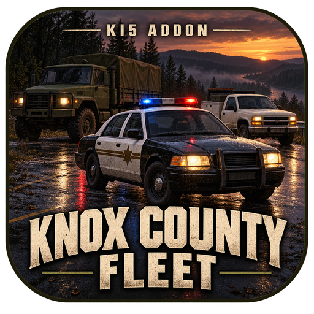

# KI5: Knox County Fleet

Put KI5 on Kentucky's roads. **Knox County Fleet** brings KI5-only traffic, regional police liveries, profession vehicles, roadside stories and military fleet tuning together for **Project Zomboid Build 42.21**.



**0.1.0 — public source / Workshop release candidate.** Independently authored community addon by Erika (prg299). Based on the author's private Vehicle Suite 1.1.4 with a new mod ID, renamed runtime files, separately obtained vehicle/skin dependencies and a public build profile. Workshop publication and native gameplay acceptance are pending; this repository is not a claim of a tested public Steam release.

## What it does

- Replaces normal, crash, profession/story and audited direct vanilla vehicle selections through one late server-side KI5 catalog.
- Routes police liveries by region, including Louisville city/county, Muldraugh, Meade, West Point, airport and prison roles.
- Keeps the private Suite's defaults: 95% Humvee within military cars, 75% AM General within military trucks, a preferred M35A2 transport share and 95% white EMS F350 within ambulance choices. These are candidate-pool shares, not a promise that 95% of all spawned vehicles are military.
- Preserves WayMoreCars highway aliases and VMZ's split military pools. Those mods are optional.
- On multiplayer servers, gives eligible newly spawned police vehicles a 50% silent flashing-lightbar chance outside dedicated emergency stations. Single-player lightbar parity is not claimed by this inherited server-only callback.
- Leaves existing saved vehicles/chunks unchanged. Changes affect newly generated vehicles.

## Install

This is a **full-fleet integration with a large dependency set**. Install the exact original Workshop items and enable their modules listed in [dependencies](docs/dependencies.md), then enable `KI5KnoxCountyFleet` after them. No dependencies are repacked. Avoid the incompatible private Suite/World Vehicles/Regional Police/No Vanilla modules. Do not enable original LFPSP beside the required hotfix.

For a manual test install, copy `mod/KI5KnoxCountyFleet` to your own `Zomboid/mods` directory. Use a disposable world first. No automatic deployment, subscription or server/playset changes are performed by these tools. Replacing the old mod in an established server needs its own backed-up migration/acceptance pass.

## Development

Requires PowerShell 7, Python 3.10+, JDK 25 for the native uploader adapter, and local read-only Project Zomboid/Workshop downloads. Set `PZ_GAME_DIR` and `PZ_WORKSHOP_DIR` when they differ from the documented Windows defaults, and `KCF_JAVA_HOME` to your JDK 25 root when it is not your default compiler. `config/fleet-profile.ini` is the explicit public input; your server configuration is never read.

On this workstation, all checks, builds and browser/native reviews run through the owner-required resource guard:

```powershell
node C:/Users/erika/.codex/tools/run-heavy.mjs -- pwsh -NoProfile -File scripts/generate-fleet-catalog.ps1
node C:/Users/erika/.codex/tools/run-heavy.mjs -- python scripts/check-repository.py
node C:/Users/erika/.codex/tools/run-heavy.mjs -- pwsh -NoProfile -File scripts/validate-lua.ps1
node C:/Users/erika/.codex/tools/run-heavy.mjs -- pwsh -NoProfile -File scripts/test-spawn-policy.ps1
node C:/Users/erika/.codex/tools/run-heavy.mjs -- python scripts/stage-workshop.py
node C:/Users/erika/.codex/tools/run-heavy.mjs -- pwsh -NoProfile -File scripts/validate-stage.ps1
```

CI runs the portable repository and PowerShell parser checks without proprietary game files. It cannot run the installed-game Lua/compiler or native gameplay checks. Other contributors can invoke those scripts with their own resource-management setup; the guard path above is specific to the author's workstation.

`mod/` contains the deliverable. `scripts/` owns generation/check/stage tools; `tools-src/` holds authored harnesses and artwork masters; `config/` pins selected modules; `docs/` records architecture, source/rights evidence and acceptance gaps; `release/workshop/` contains fresh-item metadata. Build/test output remains ignored under `build/`.

## License and status

[MIT](LICENSE) for authored contributions. Read [credits](CREDITS.md), [third-party notices](THIRD_PARTY_NOTICES.md), [compatibility](docs/compatibility.md) and [release readiness](docs/release-readiness.md). This addon is not affiliated with or endorsed by KI5 or The Indie Stone.
