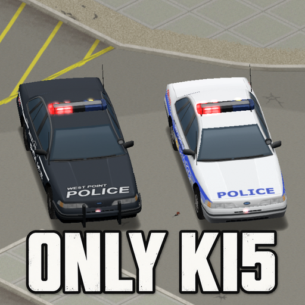

# Only KI5: Vehicle Spawn & Livery Overhaul

Put KI5 on Kentucky's roads. **Only KI5: Vehicle Spawn & Livery Overhaul** brings KI5-only traffic, regional police liveries, profession vehicles, roadside stories and military fleet tuning together for **Project Zomboid Build 42.21**.



**0.3.1 — public source / Workshop release candidate.** Community integration by Erika (prg299), based on the author's private Vehicle Suite 1.1.4. Includes attributed More Car Variants, Consistent Camo, police skins/hotfix, Vehicle Military Zones and No Vanilla duplicate-selection data. Original KI5 vehicles, damnlib and More Car Features remain external. Authored native world helpers replace YAPZLib; no separate support library is needed. Native single-player and two-client dedicated-server results are recorded in [native acceptance](docs/native-acceptance.md). Workshop publication remains pending.

## What it does

- Replaces normal, crash, profession/story and audited direct vanilla vehicle selections through one late server-side KI5 catalog.
- Routes police liveries by region, including Louisville city/county, Muldraugh, Meade, West Point, airport and prison roles.
- Keeps the private Suite's defaults: 95% Humvee within military cars, 75% AM General within military trucks, a preferred M35A2 transport share and 95% white EMS F350 within ambulance choices. These are candidate-pool shares, not a promise that 95% of all spawned vehicles are military.
- Requires More Car Features / WayMoreCars and preserves its highway aliases. Integrated Vehicle Military Zones supplies military locations, split pools, sandbox settings and four road-story recipes. Internal authored helpers use native game APIs for zones, angled parking and scene construction/scheduling.
- In single-player and multiplayer, gives eligible newly spawned police vehicles a 50% silent flashing-lightbar chance outside dedicated emergency stations. The spawn policy clears siren modes before every station, saved-decision and existing-light check.
- Leaves existing saved vehicles/chunks unchanged. Changes affect newly generated vehicles.

## Install

This is a **full-fleet integration** with 87 external Workshop requirements, including the original KI5 fleet. Install and enable the modules in [dependencies](docs/dependencies.md), then enable `OnlyKI5VehicleSpawnLiveryOverhaul` after them. The only non-vehicle dependencies are damnlib and More Car Features / WayMoreCars. YAPZLib is neither required nor bundled; keep it enabled if another mod needs it. Disable the integrated originals: all four MCV modules, both Consistent Camo modules, original LFPSP and its B42 hotfix, VMZNEW, No Vanilla selection modules, and the private Suite/World Vehicles/Regional Police integrations. They would duplicate this package's registrations or assets.

For a manual test install, copy `mod/OnlyKI5VehicleSpawnLiveryOverhaul` to your own `Zomboid/mods` directory. Use a disposable world first. No automatic deployment, subscription or server/playset changes are performed by these tools. Replacing the old mod in an established server needs its own backed-up migration/acceptance pass.

**Highly recommended:** [KI5 Vehicle Performance Patch (Unofficial)](https://steamcommunity.com/sharedfiles/filedetails/?id=3808100388) by lucygoosey. It is optional and remains external; follow its server/client setup instructions. It was not part of this candidate's native acceptance profile.

## Development

Requires PowerShell 7, Python 3.10+, JDK 25 for the native uploader adapter, and local read-only Project Zomboid/Workshop downloads. Set `PZ_GAME_DIR` and `PZ_WORKSHOP_DIR` when they differ from the documented Windows defaults, and `ONLY_KI5_JAVA_HOME` to your JDK 25 root when it is not your default compiler. `config/fleet-profile.ini` is the explicit public input; your server configuration is never read.

On this workstation, all checks, builds and browser/native reviews run through the owner-required resource guard:

```powershell
node C:/Users/erika/.codex/tools/run-heavy.mjs -- python scripts/import-content.py
node C:/Users/erika/.codex/tools/run-heavy.mjs -- pwsh -NoProfile -File scripts/generate-fleet-catalog.ps1
node C:/Users/erika/.codex/tools/run-heavy.mjs -- python scripts/sync-release-metadata.py
node C:/Users/erika/.codex/tools/run-heavy.mjs -- python scripts/check-repository.py
node C:/Users/erika/.codex/tools/run-heavy.mjs -- pwsh -NoProfile -File scripts/validate-lua.ps1
node C:/Users/erika/.codex/tools/run-heavy.mjs -- pwsh -NoProfile -File scripts/test-spawn-policy.ps1
node C:/Users/erika/.codex/tools/run-heavy.mjs -- pwsh -NoProfile -File scripts/check-native-world-api.ps1
node C:/Users/erika/.codex/tools/run-heavy.mjs -- python scripts/stage-workshop.py
node C:/Users/erika/.codex/tools/run-heavy.mjs -- pwsh -NoProfile -File scripts/validate-stage.ps1
```

After reviewing upstream changes, run `scripts/import-content.py` before regenerating the catalog. It reads only the sources in `config/bundled-sources.json`, preserves file provenance, merges localization, filters six reviewed stale MCV definitions, remaps military helper imports to authored native implementations, and replaces only its unchanged manifested outputs. It never reads a private server configuration. Imported art retains upstream bytes and is not regenerated.

CI runs the portable repository and PowerShell parser checks without proprietary game files. It cannot run the installed-game Lua/compiler or native gameplay checks. Other contributors can invoke those scripts with their own resource-management setup; the guard path above is specific to the author's workstation.

`mod/` contains the deliverable. `scripts/` owns generation/check/stage tools; `tools-src/` holds authored harnesses and artwork masters; `dev/` owns isolated native acceptance drivers; `config/` pins selected modules; `docs/` records architecture, source/rights evidence and acceptance gaps; `release/workshop/` contains fresh-item metadata. Build/test output remains ignored under `build/`.

## License and status

[MIT](LICENSE) for authored contributions only. Integrated third-party code, data and assets listed in `docs/imported-content.json` retain their original ownership and are excluded from MIT. Read [credits](CREDITS.md), [third-party notices](THIRD_PARTY_NOTICES.md), [compatibility](docs/compatibility.md) and [release readiness](docs/release-readiness.md). This addon is not affiliated with or endorsed by KI5 or The Indie Stone.

**Original authors:** if you prefer your integrated content to be distributed separately, contact Erika/prg299 through Steam or a [GitHub issue](https://github.com/prg299/Only-KI5-Vehicle-Spawn-and-Livery-Overhaul/issues). The integrated copy will be removed and your original mod made an external dependency, with credits and load-order instructions retained.
