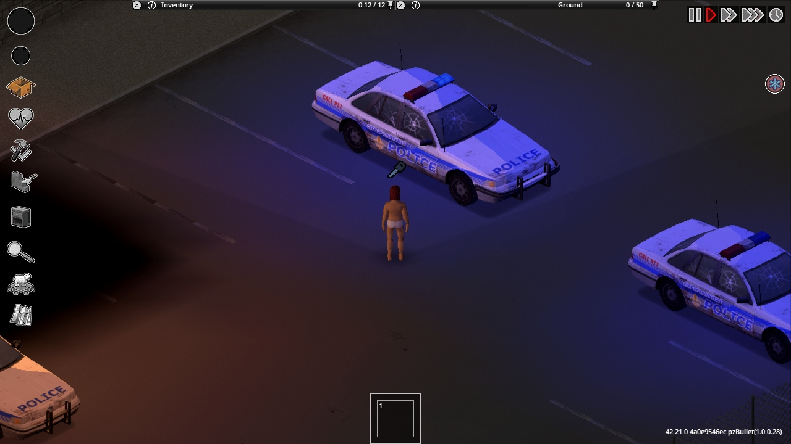
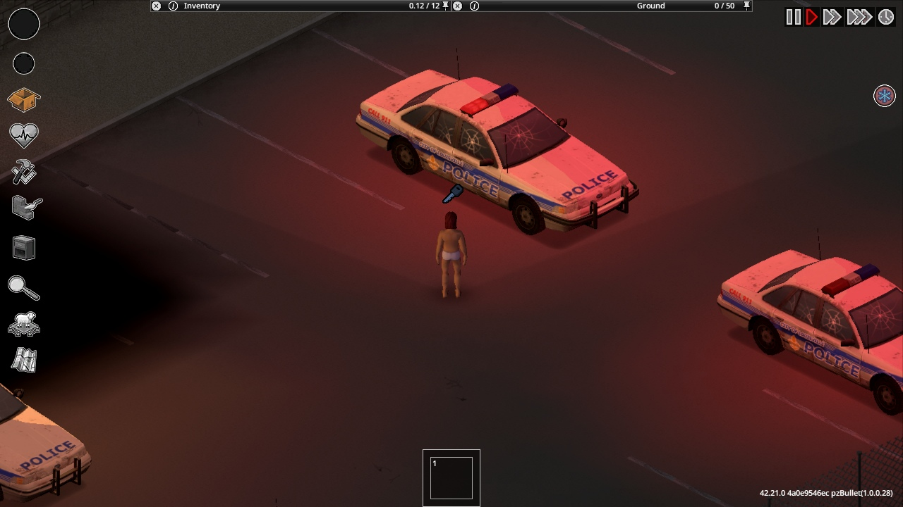

# Native release acceptance

Tested 2026-10-23 on Project Zomboid 42.21.0 (`4a0e9546ec`, Steam build 25485521). The native checks below passed in disposable worlds and an ordinary dedicated server with two joined native clients. An unlisted Steam testing item is uploaded; public release remains pending and the limits below are not claimed as passed.

## 0.3.2 focused livery follow-up

The only player-payload changes are the new SpawnSkins module, its call from the existing pre-creation router and the two version descriptors. The catalog, vehicle-class selection and military pools are unchanged. The running dedicated server reports 95.0% Humvee share in general military, light-military and highway military-car groups; both joined/rejoined checks assert those weights.

The exhaustive production-Lua fixture verifies 95% ordinary / 4% medic / 1% JTF per new eight-skin Humvee, alternate six-skin indices, client exclusion, unknown-layout exclusion, saved vehicles and repeat callbacks. All 56 runtime Lua files compile; all 13 policy scenarios and six PowerShell parser checks pass.

Native SP separately observes five natural checkpoint Humvees and 20 explicit construction fixtures. Native MP separately observes one natural checkpoint Humvee and 20 explicit fixtures, with 40 authority/peer skin comparisons. All 20 fixtures in each mode retain their SQL identities, skins and saved decisions across a complete process restart; both rejoined MP clients match the server in all 40 comparisons. All four owned runs exit cleanly with no desktop switch. Small native samples do not prove population frequencies.

[Focused receipts and clean exits](validation/native-20261024-humvee/evidence.json), [raw tested payload](validation/native-20261024-humvee/tested-payload.json) and [canonical payload](validation/native-20261024-humvee/canonical-payload.json) cover the 290-file, 46,571,538-byte 0.3.2 candidate. The original evidence below remains a dated 0.3.1 record. The SP test driver initially used an unsupported save signature, then transient vehicle IDs after chunk reload; those harness issues were corrected to save(true), persisted markers and SQL identity before the clean restart comparisons. No gameplay fix was inferred from those harness failures.

## Original 0.3.1 results

| Area | Native evidence | Result |
| --- | --- | --- |
| Selected fleet | All 531 current catalog IDs resolve in the dedicated server's actual ScriptManager. Fresh single-player generation identified the four legacy B41-only IDs subsequently excluded. Candidate and adapter hashes retained per run. | Registry and full-fleet world load passed |
| Louisville checkpoint | Fresh military light/heavy/trailer zones, angled placements and consistent camo inspected in single-player. Multiplayer sample observed eight native vehicles within its recorded area. | SP visuals and joined MP sample passed |
| Louisville highway | SP approach observation: 46 loaded vehicles, including 24 modified_trfjm, 17 trafficjamn and four dedicated military-zone vehicles; no active military in the ordinary jam sample. MP approach/city samples observed 14/26 native vehicles. | Fresh generation and joined MP samples passed |
| Final highway pool | Military weight 2 / ordinary 928.800039636 = 0.215331601%, below the inherited 0.25% cap. Military cars are 95% Humvee; heavy military pools are 75% AM General. Ordinary parking has zero active military weight. | Live server pool audit passed |
| Four road stories | Native SP recipes: blockade two vehicles; blockpost two plus barriers/tent/cots/stocked lockers; convoy five including trailers plus 19 personnel zombies; biohazard two including a flipped vehicle plus four zombies. All four also constructed on the dedicated server and matched both peers. | Native construction and replication passed |
| Scene restart | All four saved done checkpoints and every recorded SQL vehicle identity/script/skin survived a full dedicated restart; no duplicate scene vehicles. Both clients match authority. Later explicitly created variant fixtures are accounted for separately. | Full restart passed |
| Police lightbar decisions | MP: 20 explicit construction fixtures, seven on/13 off, all siren modes zero. Both clients, including a late join, matched authority. SP with the corrected callback: 20 fixtures, 11 on/nine off, all siren modes zero. | SP and two-client authority passed |
| Silent audio | Deliberately enabled one siren as a positive control. On both MP clients, the native audio manager/emitter became active; the actual spawn-end callback then stopped the emitter and preserved lights mode 2. SP additionally ran with game sound volume 10 and FMOD master output bus muted: active emitter before policy, empty emitter afterward. No audible listening claim. | Native siren and audio-emitter regression passed |
| Visible flashing | Unmodified three-second clips: MP A 33 frames/B 34; red-minus-blue ROI ranges 156.18/158.85. Reloaded SP 35 frames, range 125.84. Actual red/blue frames viewed with the car visible after native movement turns the player toward it. | SP after reload and both MP clients visually passed |
| Police restart | MP: exactly one match per saved police SQL ID, all 20 scripts/skins/modes/decisions preserved; all 40 rejoined peer comparisons match. SP: all 20 preserve skins, lights, zero sirens and decisions; native siren emitters remain empty. | SP and MP restart passed |
| Station exclusion | Native policegarage ParkingStall inside TownZone: station:police, lights 0, siren 0. Lua regression covers emergency aliases, idempotence, broken/pre-existing lightbars and clearing pre-existing sirens. | Native fixture and three authority modes passed |
| Imported variants | Commando Ranger, M1010 ambulance, K10 Fossoil and F350 Fossoil render, register armor/overlays on both clients and open actual mechanics UI using native movement and the mechanics key. Part counts 46/50/47/60. Saved identities and mechanics survive restart. | Four representative families passed |
| Variant names | All 23 MCV English names resolve exactly on both rejoined clients; actual mechanics headers show their names. | Native B42 JSON translations passed |
| Production inputs | Native Forward/W moves the player; native mouse clicks complete character screens; native movement faces cars and the bound mechanics key opens/closes the real UI. | Movement, character and mechanics dispatch passed |

Pool shares and small road samples are not measured population frequencies. SP and MP counts use different loaded footprints and cannot establish a density trend. The upstream highway pool has no military-truck role, so its AM General truck share is inapplicable. Four stories were explicitly selected into pending native checkpoints, then built by the actual deferred scheduler/native APIs. This proves construction, not natural selection probability or day limits. One convoy fixture first refused an occupied footprint; its explicitly prepared empty test road is recorded separately. Nearby MP totals include ambient vehicles and must not be presented as recipe counts. Explicit fixture cars are excluded from natural traffic samples.

## Fixes found in the game

- The catalog generator combined B41 root media with selected B42 content. TrailerM1082tarp, TrailerM1095tarp, 78amgeneralM35A2Burnt and 83amgeneralM923Burnt did not exist in the native registry. Selected B42 plus common/media now supplies 531 real IDs. Active trucks retain 75% AM General weighting; burnt trucks use available native wrecks.
- The station guard read TownZone instead of emergency ParkingStall names. It now checks native stall names first, including policegarage/firegarage/firetruck and military child names.
- Five inherited military lightbar writes set mode 2 on vehicles lacking lightbar hardware. The authored helper checks hasLightbar first; server and clients now agree for every tested scene.
- Legacy MCV TXT names were ignored by B42.21. The importer produces native JSON, verified for all 23 strings on both clients.
- Silent police lightbars registered only on servers. Registration now also covers single-player, while joined clients still return without rolling decisions. Sirens are cleared before station, saved-decision or existing-light checks. This is spawn policy; normal player siren controls remain usable afterward.

## Evidence and reproduction

[Whitelisted native receipts](validation/native-20261023/evidence.json), [tested candidate hashes](validation/native-20261023/tested-payloads.json), [immutable input fingerprints](validation/native-20261023/external-input-fingerprints.json) and [unmodified image hashes](validation/native-20261023/images.json) are public. The final 289-file local payload matches the native SP silent-audio and restart candidates byte for byte. Git normalizes text line endings to LF; [canonical payload hashes](validation/native-20261023/canonical-payload.json) record that packaging boundary alongside raw native hashes. Earlier MP candidate hashes identify precisely what was tested; the subsequent registration change enables SP without changing the MP callback body.

Raw profiles, logs, credentials and crash arguments stay ignored under build/native. Successful runs are full-fleet-20261023-c; multiplayer-20261023-b and c-reload; multiplayer-20261023-f-final and g-acceptance-reload; singleplayer-20261023-h-silent and i-reload. F/G prove the military, representative variant and restart paths. H/I prove the final SP registration, silent audio and persistence. All these native lifetimes shut down with exit code 0.

Run the entire dev/native-session.py lifetime through the workstation resource guard with a resolved real Python executable. It owns inactive-desktop clients, disposable caches and an optional dedicated server. RVI's MIT endpoint/input/framebuffer sources and desktop keeper are read-only local inputs. ZombieBuddy is test-only, never a player dependency. NativeLab serializes broker actions. Server fixture calls, teleports and forced story selections are setup, not production input evidence. The test-only Audio Java adapter mutes the native FMOD master bus before enabling game sound; resumed profiles initially force volume zero.

The dedicated server uses loopback non-Steam transport, DoLuaChecksum=true and AntiCheatChecksum=2. Steam transport, production hosting, every armor installation, trailer driving, other map combinations, sandbox UI permutations, long-run performance and human acceptance remain unverified.

## Environment and failed probes

The initial two-client configuration exhausted the unchanged 16 GiB child-tree cap (peak 16.01 GiB); all three JVMs failed allocations. Four workers, reduced view range and colocated players allowed successful runs. Final military F peaked at 15.46 GiB; restart/audio G at 15.81 GiB; SP H/I at 6.98/7.40 GiB. These are guard measurements, not a performance benchmark. No OS changes, cap increase or unrelated-process cleanup occurred.

Earlier startup/TOS readiness attempts do not establish gameplay. The first WindowsApps Python alias escaped accounting; later real-Python receipts confirm keeperInJob/gameInJob. Owned profiles reuse existing acknowledgements without accepting new terms. Partial SP reload D and MP E were interrupted by disposable-character deaths: client-only God flags do not protect dedicated authority. F/G set and verify server protection; H/I use a fresh no-zombie world. Premature loading probes, missing native facing and invalid recording names are harness failures, not passes. A native key-to-glovebox warning occurred during an explicit SP vehicle fixture and is retained in private logs; this is not a pristine-log claim.

Installed PZ_Optimization Lua and existing dependency warnings remain present. Native runs select stock engine classes first and disable Java optimization overrides. Compiler fixtures disclose their override classpath. One early diagnostic rewrote the installed launcher heap; the task restored the previously approved 10240 MiB setting and removed its temporary marker, with private before/after receipts. No real save, active server, host heap, subscription or load order changed. Captures retain the game and vehicle creators' rights.
